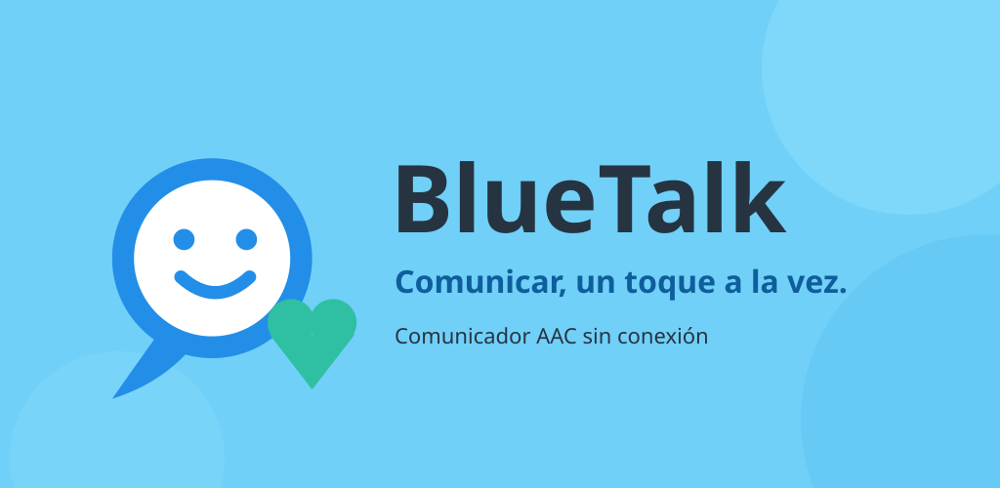
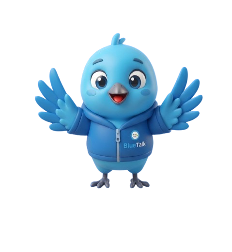
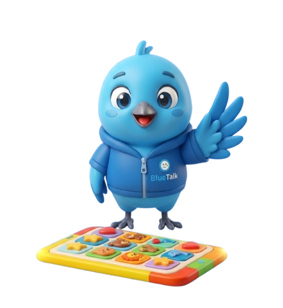
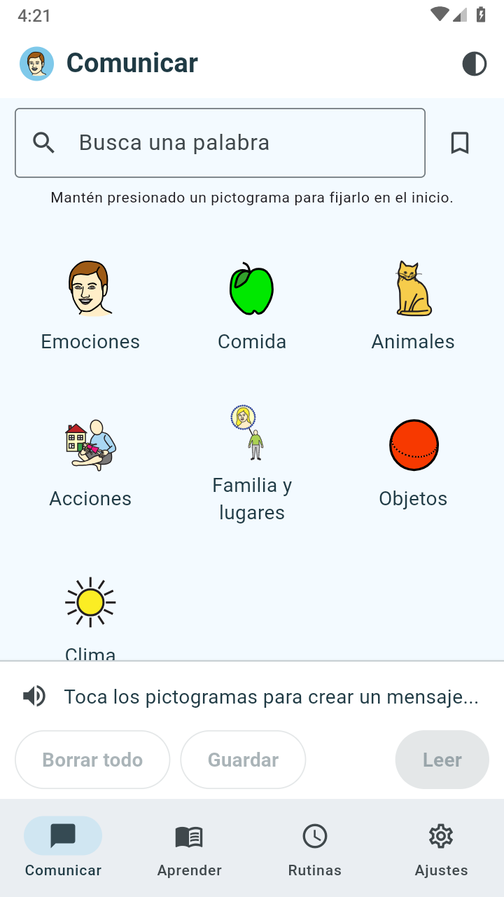
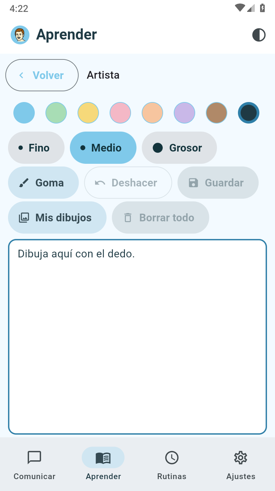
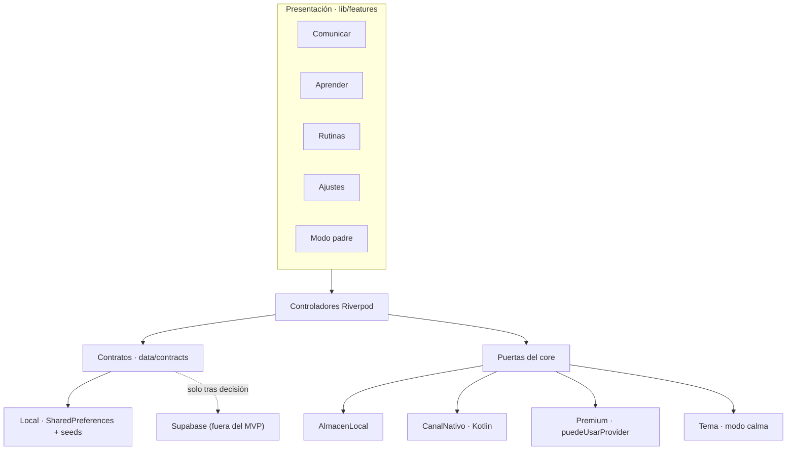

<p align="center">
  
</p>

<h1 align="center">BlueTalk 💙</h1>

<p align="center">
  <strong>Tu voz, siempre contigo.</strong><br>
  Comunicación aumentativa y alternativa (AAC) en español, inspirada en PECS, para niñas y niños autistas y sus familias.<br>
  Android · 100 % sin conexión · sin cuentas · sin anuncios.
</p>

<p align="center">
  
  
  
  
  
  
  
</p>

<p align="center">
  
</p>

> **En una frase:** un tablero de pictogramas que habla solo cuando el niño lo toca, con rutinas, juegos y un panel para el adulto. El apodo, los favoritos y el progreso se quedan en el teléfono.

## Índice

| | | |
|---|---|---|
| [1. Qué es BlueTalk](#1-qué-es-bluetalk) | [2. Estado del proyecto](#2-estado-del-proyecto) | [3. Cómo funciona](#3-cómo-funciona) |
| [4. Tecnologías y versiones](#4-tecnologías-y-versiones-exactas) | [5. Arquitectura](#5-arquitectura) | [6. Buenas prácticas](#6-buenas-prácticas) |
| [7. Empezar a trabajar](#7-empezar-a-trabajar) | [8. Sacar el APK](#8-sacar-el-apk) | [9. Google Play](#9-google-play) |
| [10. Modelo B2C, AWS y freemium](#10-modelo-b2c-aws-y-freemium) | [11. Hoja de ruta](#11-hoja-de-ruta) | [12. Documentación](#12-documentación) |
| [13. Privacidad y licencias](#13-privacidad-y-licencias) | | |

## 1. Qué es BlueTalk

BlueTalk es una app Android de **comunicación aumentativa y alternativa** para niñas y niños autistas que necesitan apoyo para comunicarse, y para las familias, docentes y terapeutas que los acompañan. No es una app de diagnóstico ni de terapia: es una herramienta para pedir, contar, elegir y anticipar lo que viene.

Está pensada para funcionar en **celulares de gama baja**, **sin internet** y **sin crear una cuenta**. La voz solo suena cuando se toca un pictograma o una frase; nunca se reproduce sola.

**Modelo B2C** (venta directa a la familia, sin intermediarios institucionales). El cliente es la **familia**: madre, padre o tutor. BlueTalk se distribuye directo al consumidor por Google Play (y, en el piloto, por APK) y **no hay venta institucional ni licencias por volumen** en esta etapa. Docentes y terapeutas pueden usar la app, pero quien decide —y paga, si compra extras— es la familia; por eso la configuración y, cuando exista, la compra viven dentro del panel del adulto.

| Área | Qué hace |
|---|---|
| **Comunicar** | Tablero de pictogramas por categorías, buscador y barra de frase. La frase se oye al tocar «Leer». |
| **Aprender** | Juegos de memoria, cuentos cortos y el Artista para dibujar con el dedo. Tiene límite diario configurable desde el modo padre. |
| **Rutinas** | Horario visual, tarjetas «Primero–Luego» y recordatorios locales opcionales para anticipar cambios. |
| **Salud** | Check-in emocional sencillo, con lenguaje literal y registro local. |
| **Ajustes** | 7 paletas (incluye alto contraste y modo oscuro), tamaño de texto, voz, modo calma y acceso al panel del adulto. |
| **Modo padre** | PIN de 6 dígitos, resumen, informes con gráficos, control de juegos, textos legales y observaciones con aviso de «no es diagnóstico». |

### Método PECS

**Método de referencia: PECS.** BlueTalk toma como referencia el **PECS** (*Picture Exchange Communication System*, Sistema de Comunicación por Intercambio de Imágenes), el método en el que la persona aprende a **entregar una imagen a un compañero de comunicación** para pedir, elegir o comentar, y avanza por fases hasta construir frases.

La app pone el tablero, los pictogramas y la voz bajo toque; el **intercambio ocurre entre el niño y una persona** (madre, padre, docente o terapeuta). La pantalla no sustituye al compañero de comunicación.

| Fase PECS | Qué trabaja | Apoyo en BlueTalk |
|---|---|---|
| 1. Intercambio físico | Entregar una imagen para pedir | El pictograma se toca y aparece en la barra; la entrega física la hace la persona. |
| 2. Distancia y persistencia | Buscar la imagen y llevarla al compañero | El tablero está siempre disponible y funciona sin conexión; no se registra la distancia. |
| 3. Discriminación de imágenes | Elegir la imagen correcta entre varias | Categorías, buscador y pictogramas con imagen y texto. |
| 4. Estructura de frase | Unir «quiero» + imagen | Barra de frase y «Leer». |
| 5. Preguntas y atributos | Responder «¿qué quieres?» con atributos | No cubierto por ahora. |
| 6. Comentario | Comentar en respuesta a algo o de forma espontánea | Frases guardadas y check-in; sin el protocolo de comentario de PECS. |

**Alcance honesto:** BlueTalk **no implementa el protocolo PECS completo** ni sustituye la formación de un profesional. No está afiliado a Pyramid Educational Consultants ni cuenta con una certificación PECS. El método exige un compañero de comunicación y una persona formada que guíe las fases; la app es una herramienta de apoyo para ese plan.

**Modo calma:** convierte la interfaz a grises, apaga las animaciones y respeta la opción «Quitar animaciones» de Android. Se activa en un toque y se recuerda al reiniciar.

**Freemium con una regla no negociable:** comunicar nunca es premium. El tablero, la voz del teléfono, las frases, las rutinas, los juegos y el modo calma son gratis para siempre. Los extras de pago se explican en [§10](#10-modelo-b2c-aws-y-freemium).

### Lo que BlueTalk no es

- **No diagnostica, no trata y no sustituye** a un logopeda, terapeuta ocupacional, docente o profesional sanitario.
- **No es un programa PECS completo ni está avalado por Pyramid Educational Consultants.** Se inspira en el método y en la comunicación funcional; las fases las guía una persona formada.
- **No pide cuentas, no muestra anuncios y no usa analítica** de comportamiento.
- **No envía los datos del menor a servidores del desarrollador.** El MVP no habla con la nube.
- **No promete sincronización multidispositivo.** Hoy hay un perfil por teléfono.

## 2. Estado del proyecto

Actualizado el **12 de noviembre de 2026**. Lo que no está ejecutado y visto se declara como pendiente; no se cuenta como hecho.

| Dimensión | Estado |
|---|---|
| **App Android** | MVP funcional: 4 pestañas + panel del adulto. APK de release de **~21 MB** (varía por edición y arquitectura). |
| **Calidad** | `flutter analyze` sin problemas · **435/435 pruebas en verde** · 74 archivos de prueba + 5 pruebas de integración. |
| **Android** | `compileSdk`/`targetSdk` 36 · `minSdk` 24 (Android 7.0) · R8 y reducción de recursos · alineación de 16 KB verificada. |
| **Google Play** | **Aún no publicada.** Ruta A definida: edición Play sin filtro web ni acceso al uso. Faltan firma/AAB, URL de privacidad, formularios y prueba cerrada. |
| **AWS** | Infraestructura **diseñada y probada en simulación**. No hay cuenta conectada y la app no llama a AWS. |
| **iOS / escritorio** | Fuera del alcance del MVP. |
| **Límites conocidos** | Un perfil por dispositivo · sin copia de seguridad/exportación · sin fotos propias · rendimiento de los informes pendiente de medir en teléfono real. |

**Gates de calidad actuales:**

```bash
flutter analyze     # 0 problemas
flutter test        # 435/435 (12-nov-2026)
```

La suite crece con cada etapa; el número exacto y su fecha se anotan en `docs/informes/`. La app está en construcción activa: los planes 12, 13 y 14 de [`docs/plan/`](docs/plan/) describen lo que falta y el orden previsto. El plan 15 es una propuesta de diseño (orden personalizado de pictogramas y voz propia) pendiente de aprobación.

## 3. Cómo funciona

### Flujo del niño y del adulto

```text
Onboarding («¿Cómo te llamas?» — apodo opcional)
   └─ Shell con 4 pestañas fijas (nunca se reordenan)
        ├─ Comunicar ─ pictogramas → barra de frase → «Leer» (voz al tocar)
        ├─ Aprender  ─ memoria · cuentos · artista (con límite diario)
        ├─ Rutinas   ─ horario · primero–luego · check-in
        └─ Ajustes   ─ tema · texto · voz · modo calma
             └─ Modo padre (siempre pide el PIN)
                  └─ Resumen · Informes · Control · Legal · Observaciones
```

El objetivo es la **comunicación funcional**: el niño pide, elige o comenta algo y una persona responde. La app es el tablero y la voz; el intercambio ocurre con el adulto.

El **menú de inicio** con las tarjetas grandes y la **guía de primera vez con la mascota** (plan 14) están implementados en ramas de trabajo y pendientes de integrar. La mascota que decora este README es el ave que acompañará esa guía.

<p align="center">
  
</p>


### Una pulsación, paso a paso

```text
Toque en un pictograma
  → controlador de Riverpod actualiza el estado
  → la barra de frase agrega la palabra
  → «Leer» pide la frase a flutter_tts (voz en español, sin autoplay)
  → el texto y los pictogramas se guardan en el dispositivo
```

Nada de eso usa red. Los pictogramas, cuentos, horario y reglas viven en `assets/seed/` y `assets/pictos/`; las preferencias y el progreso, en `SharedPreferences`.

### Voz

- La voz es la del sistema Android (`flutter_tts`), en español.
- **Solo suena con un toque.** No hay narración automática, ni al abrir pantallas, ni al cambiar de paso.
- Si el teléfono no tiene una voz en español, la app avisa una vez y explica cómo instalarla.
- El modo calma no cambia el volumen ni la voz: solo los colores y las animaciones.

<p align="center">
  
  &nbsp;&nbsp;
  
</p>

## 4. Tecnologías y versiones exactas

Versiones tomadas de `pubspec.lock` y de los archivos de `android/` el **12-nov-2026**. Para comprobarlas en tu copia: `flutter --version`, `flutter pub deps --style=compact` y `java -version`.

### App y paquetes

| Capa | Tecnología | Versión exacta | Por qué |
|---|---|---|---|
| SDK y lenguaje | **Flutter** / **Dart** | 3.44.4 stable / 3.12.2 | AOT nativo, buen rendimiento en 1–2 GB de RAM y un solo código para Android (e iOS a futuro). |
| Estado | `flutter_riverpod` | 3.4.3 | Seguridad en compilación y `.select()` para redibujar solo lo que cambió. |
| Rutas | `go_router` | 18.0.2 | Shell fijo, rutas declarativas y comportamiento de «Atrás» testeable. |
| Persistencia | `shared_preferences` | 2.5.6 | Datos pequeños y offline; sin esquema ni SQLite en el MVP. |
| Secretos | `flutter_secure_storage` | 11.2.0 | Keystore de Android para el PIN y datos sensibles; nunca en preferencias planas. |
| Voz | `flutter_tts` | 4.2.5 | Voz del sistema en español, control de velocidad y sin autoplay. |
| Notificaciones | `flutter_local_notifications` + `timezone` + `flutter_timezone` | 22.3.2 · 0.11.2 · 5.1.1 | Recordatorios del horario que sobreviven al reinicio, con zona horaria real. |
| PIN y biometría | `cryptography` + `local_auth` | 2.9.0 · 3.0.2 | PBKDF2-SHA256 con sal y bloqueo por intentos; huella opcional en el panel. |
| Pictogramas | `flutter_svg` | 2.3.0 | Render de los SVG de Mulberry sin convertirlos a PNG. |
| Iconos | `cupertino_icons` | 1.0.9 | Iconografía de sistema; el resto es Material Icons. |
| Lints | `flutter_lints` | 6.0.0 | Reglas base + reglas extra del plan 01 (`avoid_print`, `unawaited_futures`, etc.). |
| Accesibilidad | `accessibility_tools` | 2.8.0 (dev) | Verifica objetivos táctiles y etiquetas semánticas en las pruebas. |
| Pruebas | `flutter_test`, `flutter_driver`, `integration_test` | SDK | Unitarias, de widget, de integración y capturas en emulador. |

### Android y compilación

| Pieza | Versión exacta |
|---|---|
| Gradle Wrapper | **9.1.0** |
| Android Gradle Plugin (AGP) | **9.0.1** |
| Kotlin | **2.3.20** |
| JDK | **17** (probado con OpenJDK 17.0.20.1) |
| Android SDK | `compileSdk` **36** · `targetSdk` **36** · `minSdk` **24** |
| NDK | **28.2.13676358** |
| Desugaring | `desugar_jdk_libs` **2.1.4** |
| R8 / shrinkResources | Activos en release |
| `applicationId` | `com.limitcodev.bluetalk` |
| Versión de la app | `0.1.0+1` (`versionName` + `versionCode`) |

### Contenido y diseño

| Pieza | Detalle |
|---|---|
| Pictogramas | **235 SVG** de **Mulberry Symbols**, CC BY-SA 4.0. Vocabulario de **239 entradas**. |
| Emojis | Twemoji, CC BY 4.0 (créditos dentro de la app). |
| Tipografía | **Nunito Variable** (SIL OFL 1.1) en `assets/fonts/`. |
| Paleta | 7 temas: azul BlueTalk, verde suave, lila, durazno, gris calmado, alto contraste y modo oscuro. |
| Mascota | Ilustraciones originales del proyecto: 11 posturas para la guía; dos copias decoran este README en `docs/branding/mascota/`. |

### Decisiones que se descartaron (y por qué)

| Descartado | Motivo |
|---|---|
| **React Native / Kotlin puro** | Flutter compila AOT y evita el puente JS en gama baja; Kotlin puro limitaría a Android y multiplicaría el trabajo de UI. |
| **Supabase / Drift en el MVP** | El niño en el aula no tiene red. SharedPreferences basta para ajustes y datos simples; el remoto queda tras una decisión explícita y un contrato ya preparado. |
| **Redis / Upstash** | Poco tráfico sincronizado; PostgREST + almacenamiento local bastan. Complejidad sin beneficio. |
| **Firebase completo** | Duplicaría el backend y añadiría otro conjunto de cuentas y obligaciones de privacidad. |
| **ARASAAC** | Licencia no comercial: riesgo legal para una app publicable. |
| **Flame / Rive por defecto** | Los juegos previstos se resuelven con widgets y animaciones nativas; el peso extra no se justifica. |
| **Animaciones Lottie/GIF/MP4** | Peso, batería y poca compatibilidad con el modo calma. |
| **`speech_to_text` en el MVP** | En Android depende del servicio de Google; no es 100 % offline. |

> El detalle de cada decisión, con alternativas y fechas, está en [`docs/plan/09-stack-paquetes.md`](docs/plan/09-stack-paquetes.md) y [`docs/ARQUITECTURA.md`](docs/ARQUITECTURA.md).

## 5. Arquitectura

### Vista general



### Capas y reglas

| Capa | Responsabilidad | Regla que la protege |
|---|---|---|
| `lib/features/` | Pantallas, widgets y controladores de cada función. | No hablan con `SharedPreferences` ni crean `MethodChannel`. |
| `lib/core/almacen/` | Única puerta a `SharedPreferences`. | `test/arquitectura/capas_test.dart` |
| `lib/core/plataforma/` | Única puerta a los canales nativos de Android. | `test/arquitectura/capas_test.dart` |
| `lib/core/premium/` | Plan, funciones premium y contratos de compra. | Ninguna pantalla consulta la tienda por su cuenta. |
| `lib/data/` | Modelos, contratos y repositorios locales. | `mock_repos.dart` solo reexporta; un archivo por repositorio. |
| `lib/app/di.dart` | Raíz de composición: elige implementaciones. | Es el único sitio que las conecta. |

**Reglas que hacen cumplir las pruebas:**

- Solo `core/almacen`, `data/local` y la raíz de composición importan `shared_preferences`.
- Solo `core/plataforma` crea `MethodChannel`; si el canal no existe, devuelve `null`, nunca lanza.
- **Trinquete de 100 líneas:** ningún archivo nuevo de `lib/` pasa de 100 líneas; los antiguos solo encogen (la deuda está listada en `test/arquitectura/tamano_test.dart`).
- **Comunicar nunca es premium:** el catálogo `Funcion` solo tiene extras (`vocesNaturales`, `paquetesVocabulario`).

### Patrones que se usan

| Patrón | Dónde vive | Por qué |
|---|---|---|
| **Feature-first** | `lib/features/<área>/` | Cada función tiene su carpeta y sus pruebas; se puede partir sin tocar las demás. |
| **Repository** | `data/contracts/` + `data/local/` | Las pantallas dependen de un contrato, no de `SharedPreferences`; cambiar el almacenamiento no rompe la UI. |
| **Composition root** | `lib/app/di.dart` | Un solo sitio decide qué implementación se usa; el resto del código no instancia dependencias. |
| **Estado unidireccional** | Controladores Riverpod | La pantalla lee estado y envía acciones; no guarda lógica de negocio. |
| **Adapter / puerta nativa** | `core/plataforma/` | Kotlin queda detrás de una interfaz pequeña y testeable; si el canal falta, devuelve `null`. |
| **Sin generación de código** | Todo el proyecto | No hay `build_runner`: menos pasos, menos archivos generados y menos magia para quien llega nuevo. |

### Mapa del repositorio

```text
lib/
├── app/          router, shell, DI, tema raíz
├── core/         almacén, canal nativo, premium, tema, widgets comunes
├── data/         modelos, contratos, repositorios locales y seeds
└── features/     comunicador, juegos, rutinas, salud, ajustes, padre, onboarding

assets/
├── brand/        logo de la app
├── fonts/        Nunito Variable + OFL
├── pictos/       235 SVG de Mulberry
└── seed/         categorías, pictogramas, cuentos, horario y reglas

android/          proyecto Android (Kotlin + Gradle)
docs/             planes, informes, legal, Play, infraestructura y marca
scripts/          builds, límites de Gradle y utilidades de AWS
test/             unitarias, widget, arquitectura y accesibilidad
integration_test/ flujos nativos y capturas en emulador
```

### Flujo de datos de una acción

```text
Widget → controlador Riverpod → contrato (data/contracts)
       → repositorio local (data/local) → AlmacenLocal
       → SharedPreferences o seed en assets
       → nuevo estado → la UI se redibuja solo donde cambió
```

## 6. Buenas prácticas

### Privacidad por diseño

- **Cero datos reales en el repositorio.** Nombres, colegios y contactos son de demostración.
- El apodo es opcional y se guarda **solo en el teléfono**.
- Sin cuentas, sin anuncios, sin analítica y sin telemetría de comportamiento.
- `allowBackup=false`: los datos no viajan en copias de seguridad del sistema.
- La edición Play **no declara `INTERNET`**; la edición `directa` solo la usa para el filtro DNS local del adulto.
- El PIN se guarda con **PBKDF2-SHA256 + sal**, comparación en tiempo constante y bloqueo por intentos. La biometría es opcional.
- Nunca se escriben claves, tokens ni contraseñas en el código, los commits o los logs. `android/key.properties`, `*.jks` y `.env` están en `.gitignore`.

### Accesibilidad

- Objetivos táctiles de **≥ 48 dp** y contrastes **AA** verificados por pruebas.
- Lenguaje literal: «Recreo, hecha», no metáforas.
- Navegación fija y predecible; el vocabulario nuclear no se reordena.
- **Ningún sonido automático**: la voz solo suena bajo toque.
- El modo calma apaga animaciones y respeta la configuración del sistema.
- Etiquetas `Semantics` y pruebas con `accessibility_tools` para TalkBack.

### Rendimiento en gama baja

| Medida | Cómo se aplica |
|---|---|
| Renderer | Impeller por defecto; **no** se hace precarga de shaders SkSL (consejo obsoleto). |
| Imágenes | `cacheWidth` para decodificar al tamaño mostrado y tope de `ImageCache` (50 imágenes / 20 MB). |
| Trabajo pesado | JSON y cálculos fuera del hilo principal con isolates. |
| Rebuilds | Riverpod `.select()` para redibujar solo la parte afectada. |
| APK | R8 + `shrinkResources` + `--split-per-abi`; el APK de reparto pesa **~21 MB**. |
| Arranque | Objetivo < 3 s en frío; prueba en emulador API 28 con 1 GB de RAM y GPU por software. |

**Pendiente honesto:** el informe mensual del adulto se midió en **39,4 ms de media** en el emulador con `swiftshader_indirect`; el objetivo es ≤ 16 ms. Falta medirlo en un teléfono real antes de dar el rendimiento por cerrado.

### Calidad y pruebas

| Puerta | Qué comprueba |
|---|---|
| `flutter analyze` | 0 problemas; lints del proyecto y reglas extra. |
| `flutter test` | 435 pruebas: unitarias, widget, arquitectura, accesibilidad y contraste. |
| `test/arquitectura/capas_test.dart` | Que las capas no se salten sus puertas. |
| `test/arquitectura/tamano_test.dart` | Que no crezcan los archivos de más de 100 líneas. |
| `test/arquitectura/manifiesto_test.dart` | Que los permisos declarados sean los justificados. |
| `integration_test/` + `flutter_driver` | Flujos nativos, capturas y perfilado en emulador. |

Antes de cada commit: `flutter analyze` en 0 y `flutter test` en verde. Un cambio coherente por commit, mensaje corto en español (`FEAT`, `FIX`, `PERF`, `TEST`, `DOCS`, `REFACTOR`, `CHORE`) y sin texto generado por IA. Las decisiones y la evidencia de cada etapa quedan en `docs/informes/`.

### Dependencias y documentación

- Cada paquete debe justificar su peso; si se resuelve con widgets nativos, no entra librería.
- No se añaden dependencias nuevas sin una nota en el plan y aprobación explícita.
- Cada fase se cierra con su archivo de evidencia; lo no verificado se declara **NO VERIFICADO**.
- Si el código contradice un plan, se anota en `docs/informes/decisiones-pendientes.md` y se propone el cambio mínimo.

## 7. Empezar a trabajar

### Requisitos

| Herramienta | Versión usada | Nota |
|---|---|---|
| **Flutter** | 3.44.4 stable | Incluye Dart 3.12.2 y DevTools 2.57.0. |
| **JDK** | 17 | Probado con OpenJDK 17.0.20.1. |
| **Android SDK** | API 36 | `compileSdk`/`targetSdk` 36; `minSdk` 24. |
| **Git** | Cualquiera reciente | Para clonar y versionar. |
| **Python** | 3.14 (opcional) | Solo para los scripts de AWS; la app no lo necesita. |

Comprueba el entorno con:

```bash
flutter doctor -v
flutter devices
```

### Clonar y ejecutar

```bash
git clone https://github.com/LimitCodev/BlueTalk.git
cd BlueTalk
flutter pub get
flutter run
```

`flutter run` usa la edición **`play`** por defecto (`default-flavor: play` en `pubspec.yaml`). Para probar el filtro web y el acceso al uso, usa la edición `directa`:

```bash
flutter run --flavor directa
```

### Las dos ediciones

| Flavor | Para qué | Qué incluye |
|---|---|---|
| **`play`** | Publicación en Google Play (ruta A). | Comunicador, juegos, rutinas, salud, modo padre y notificaciones. **Sin** `INTERNET`, VPN ni acceso al uso. |
| **`directa`** | APK para el piloto fuera de Play. | Todo lo anterior + filtro de páginas por VPN local y diagnóstico de uso, siempre con consentimiento del adulto. |

Ambas comparten `applicationId`, así que el piloto se puede actualizar encima **si la firma coincide**. La edición Play no pide permisos que bloqueen el panel del adulto.

## 8. Sacar el APK

### La forma simple: un comando

Desde la raíz del repositorio, después de `flutter pub get`:

```bash
./scripts/build-apk.sh
```

El script compila la edición `directa` en release, separa por arquitectura y deja el APK listo para compartir:

```text
dist/BlueTalk.apk                         ← arm64-v8a, el de casi todos los teléfonos
build/app/outputs/flutter-apk/app-*.apk   ← un APK por arquitectura
```

También imprime el **SHA-256** de cada archivo para que quien lo reciba pueda comprobar que no cambió.

### Si prefieres hacerlo a mano

```bash
# Un APK por arquitectura (recomendado para repartir)
flutter build apk --release --flavor directa --split-per-abi

# Un único APK «gordo» para probar rápido
flutter build apk --release --flavor directa

# Edición Play, sin VPN ni acceso al uso
flutter build apk --release --flavor play
```

Las salidas quedan en `build/app/outputs/flutter-apk/`. Para arm64 el archivo es `app-arm64-v8a-directa-release.apk`.

### Instalar en el teléfono

Con cable y `adb`:

```bash
adb install -r build/app/outputs/flutter-apk/app-arm64-v8a-directa-release.apk
```

O copia `dist/BlueTalk.apk` al teléfono y ábrelo. Android y Play Protect avisarán porque el archivo no viene de Play Store: es normal. La guía con capturas y el texto para compartir están en [`docs/play/instalar-apk.md`](docs/play/instalar-apk.md).

Comprobar el archivo:

```bash
sha256sum dist/BlueTalk.apk
```

El resultado debe coincidir **exactamente** con el hash publicado junto al enlace.

### Firma: lo que debes saber

| Situación | Firma | Sirve para |
|---|---|---|
| No existe `android/key.properties` | Clave de depuración | Probar la app. **No** para publicar. |
| Existe `key.properties` + keystore | Clave de release | Piloto y Play Store. |
| `./scripts/build-aab.sh` | Release + ofuscación | Subir el AAB a Play Console. |

- El keystore y `android/key.properties` **nunca** se suben al repositorio (ya están ignorados). Si falta el keystore, el script del AAB se detiene con un mensaje claro.
- El AAB guarda los símbolos de ofuscación en `dist/simbolos/`; sin ellos no se pueden leer los errores de esa versión. Guárdalos junto al keystore.
- `scripts/build-aab.sh` produce `dist/BlueTalk-<versión>.aab` y su SHA-256.

## 9. Google Play

**BlueTalk todavía no está en Play Store.** La ruta elegida es la **A**: publicar la edición `play` sin el filtro web ni el acceso al uso, que son funciones de control parental con requisitos adicionales. El comunicador, las rutinas, los juegos, el modo calma y el panel del adulto siguen intactos.

| Requisito | Estado |
|---|---|
| Cuenta de desarrollador y verificación | Pendiente (decisión del dueño). |
| AAB firmado y verificado | Script listo; falta ejecutarlo con el keystore y comprobar la huella. |
| Ficha de Play | Icono 512×512, gráfico 1024×500 y textos listos; capturas pendientes. |
| Política de privacidad pública | Falta URL y correo reales. |
| Data safety, salud, familias y clasificación | Pendientes de completar en Play Console. |
| Prueba cerrada | 12 testers o más durante 14 días seguidos (regla para cuentas personales nuevas). |
| Acceso a producción | Se solicita después de la prueba cerrada; la revisión puede tardar días. |

Los textos de la ficha, los permisos y el calendario están en:

- [`docs/play/ficha.md`](docs/play/ficha.md) — nombre, descripciones y assets.
- [`docs/play/permisos.md`](docs/play/permisos.md) — cada permiso y su justificación.
- [`docs/play/lanzamiento.md`](docs/play/lanzamiento.md) — pasos y plazos de Play Console.
- [`requisitosPlayStore.md`](requisitosPlayStore.md) — auditoría completa de requisitos y brechas.

No hay fecha de publicación. El README no promete plazos que dependan de revisiones de Google.

## 10. Modelo B2C, AWS y freemium

### Modelo B2C freemium

BlueTalk es **B2C**: la familia es el cliente y quien decide. Se distribuye directo por Google Play, sin venta institucional ni licencias por volumen. El modelo es **freemium**: comunicar es gratis para siempre y los extras se compran desde el modo padre. La recomendación es una **compra única no consumible**, no una suscripción recurrente para familias.

### La idea central

**AWS trabaja antes de compilar, no mientras el niño usa la app.** La app es offline: no hay Lambda, ni base de datos remota, ni Cognito, ni servidores. Cada pieza se usa en el equipo del desarrollador o para servir una página estática.

| Servicio | Para qué | Cuándo | Coste esperado |
|---|---|---|---|
| **Amazon Polly** | Generar los MP3 de las voces naturales del vocabulario. | Una vez por cambio de vocabulario, antes de compilar. | Céntimos por voz completa (referencia: ~0,02 USD por 239 palabras y voz). |
| **S3 privado** | Guardar la página legal y, más adelante, paquetes premium. | Siempre. | < 0,01 USD/mes por pocos MB. |
| **CloudFront** | Servir la URL pública de la política de privacidad (obligatoria en Play). | Siempre. | 0 USD dentro del nivel gratuito (1 TB y 10 M peticiones/mes, sujeto a cambios). |
| **Budgets** | Avisar por correo si el gasto supera el límite (5 USD por defecto). | Siempre. | No verificado; los presupuestos básicos no suelen cobrarse. |
| **Device Farm** | Probar el APK en teléfonos y tablets reales antes de la prueba cerrada. | A demanda, manual. | Por minuto de dispositivo. |

> Precios y niveles gratuitos verificados el **7-nov-2026**; AWS los cambia. Confirma en la página oficial antes de pagar.

**Ojo con el nivel gratuito:** las cuentas creadas desde el **15-jul-2025** ya no tienen 12 meses gratis. Reciben 100 USD de crédito y el plan gratuito se cierra a los **6 meses** o al agotar los créditos, lo que ocurra antes. La URL de privacidad debe seguir viva mientras la app esté en Play, así que hay que pasar a plan de pago antes de ese límite. Aun así, el coste esperado es de céntimos al mes.

### Qué es gratis y qué es premium

La regla está en el código (`lib/core/premium/plan.dart`): **comunicar nunca es premium**.

| Función | Qué añade | Estado |
|---|---|---|
| `vocesNaturales` | Voces grabadas con Polly en lugar de la voz del teléfono. | Generador listo; falta el reproductor de MP3. |
| `paquetesVocabulario` | Paquetes de palabras extra servidos desde CloudFront. | Infraestructura lista; sin descarga en la app. |

Las pantallas preguntan siempre con `ref.watch(puedeUsarProvider(Funcion.x))`; nunca consultan Play directamente. Para probar la interfaz premium sin comprar:

```bash
flutter run --dart-define=BLUETALK_PLAN=premium
```

### Compra en Play (pendiente de decisión)

Ya existen los contratos `FuenteDerechos` y `TiendaCompras`, pero **no** se ha añadido `in_app_purchase`. Cuando se apruebe:

1. Crear el producto en Play Console (recomendado: compra única no consumible, sin cobro recurrente a familias).
2. Implementar `DerechosPlayBilling` y `TiendaPlay`; sobreescribir los providers en `lib/app/di.dart`. Ninguna pantalla cambia.
3. El botón de compra va **solo dentro del modo padre**, después del PIN: la Política de Familias exige que un adulto se autentique antes de comprar.
4. Actualizar la política de privacidad: Google procesa el pago; BlueTalk no recibe datos de tarjeta.

### Infraestructura y simulación

Todo está en [`docs/infra/aws-freemium.md`](docs/infra/aws-freemium.md), con los scripts en `scripts/aws/` y la plantilla de CloudFormation en `infra/aws/cdn.yaml`. Por defecto los scripts **simulan**; para ejecutar de verdad se usa `DE_VERDAD=1`. Las pruebas sin red:

```bash
python3 -m unittest discover -s scripts/aws/polly
python3 -m unittest discover -s infra/aws -p 'test_*.py'
```

**Hoy no hay cuenta de AWS conectada y la app no llama a ningún servicio de AWS.** La infraestructura está probada en simulación, no desplegada.

## 11. Hoja de ruta

| Etapa | Estado |
|---|---|
| **Fase 0** — base Flutter, tema, modo calma, repos mock y onboarding | Cerrada. |
| **Fase 1** — recordatorios, seguridad del PIN, calidad y rendimiento medido | Cerrada. |
| **Etapa A** — botón Atrás, dibujo sin desplazamiento, instalación y APK liviano | Cerrada. |
| **Etapa B** — marca, logo, ícono y temas con contraste AA (hoy 7) | Cerrada. |
| **Plan 14C** — gráficos del panel del adulto (dona, anillo, línea, calendario, barras) | Cerrada, salvo el rendimiento en teléfono real. |
| **Plan 14A/14B** — menú de inicio y guía de primera vez con la mascota | Implementados en ramas de trabajo; pendientes de integrar. |
| **Plan 12** — modo niño/kiosko, registro de uso, panel visual y recomendaciones | Pendiente; se hará después de integrar el menú y la guía (plan 14). |
| **Plan 15** — orden personalizado de pictogramas y voz propia (propuesta, diseño multiplataforma) | Diseño escrito; no aprobado ni implementado. |
| **Fase 2** — vocabulario 200+, primero–luego, fotos propias y copia de seguridad | Parcial: vocabulario (239) y primero–luego ya existen; fotos y copia, pendientes. |
| **Fase 3** — identidad, firma, AAB, ficha y checklist en teléfono | En preparación. |
| **Freemium / AWS** — voces de Polly, paquetes y Play Billing | Diseñado y simulado; sin cuenta conectada. |

El orden y el detalle de cada etapa están en [`docs/plan/00-PLAN-MAESTRO.md`](docs/plan/00-PLAN-MAESTRO.md), [`docs/plan/11-fases-1-a-3-excelencia.md`](docs/plan/11-fases-1-a-3-excelencia.md), [`docs/plan/12-modo-nino-kiosko-y-panel.md`](docs/plan/12-modo-nino-kiosko-y-panel.md), [`docs/plan/13-pulido-uso-real.md`](docs/plan/13-pulido-uso-real.md), [`docs/plan/14-menu-mascota-graficos.md`](docs/plan/14-menu-mascota-graficos.md) y [`docs/plan/15-mejores-ajustes-padre.md`](docs/plan/15-mejores-ajustes-padre.md) (propuesta).

## 12. Documentación

| Documento | Para qué |
|---|---|
| [`docs/ARQUITECTURA.md`](docs/ARQUITECTURA.md) | Decisiones técnicas, capas, paleta y reglas de seguridad. |
| [`docs/plan/00-PLAN-MAESTRO.md`](docs/plan/00-PLAN-MAESTRO.md) | Plan completo, convenciones y criterios de aceptación. |
| [`docs/plan/01…15`](docs/plan/) | Un plan por área: base, AAC, juegos, rutinas, padre, Supabase, release, revisión, pulido, menú/mascota/gráficos y la propuesta de orden/voz propia. |
| [`docs/informes/`](docs/informes/) | Evidencia de cada etapa, auditorías y decisiones pendientes. |
| [`docs/legal/`](docs/legal/) | Política de privacidad y términos (no son asesoría legal). |
| [`docs/play/`](docs/play/) | Ficha, assets, permisos, instalación del APK y lanzamiento. |
| [`docs/infra/aws-freemium.md`](docs/infra/aws-freemium.md) | Infraestructura AWS, costes y pasos de conexión. |
| [`docs/preview/muestra-pictos.html`](docs/preview/muestra-pictos.html) | Vista previa de pictogramas en el navegador. |
| [`AGENTS.md`](AGENTS.md) | Reglas de trabajo, evidencia y honestidad del proyecto. |

## 13. Privacidad y licencias

### Privacidad

- Los datos del menor **solo viven en el dispositivo**: apodo, favoritos, progreso, horario y observaciones.
- Sin cuentas, sin anuncios, sin analítica y sin servidores del desarrollador en la edición Play.
- La política completa está en [`docs/legal/PRIVACIDAD.md`](docs/legal/PRIVACIDAD.md) y los términos en [`docs/legal/TERMINOS_Y_CONDICIONES.md`](docs/legal/TERMINOS_Y_CONDICIONES.md).
- Las observaciones y los informes son **orientativos, no diagnósticos**.

### Licencias y créditos

- **Código:** MIT. Ver [`LICENSE`](LICENSE).
- **Pictogramas:** Mulberry Symbols © Steve Lee, [CC BY-SA 4.0](https://creativecommons.org/licenses/by-sa/4.0/). Los créditos también aparecen dentro de la app.
- **Emojis:** Twemoji © Twitter, [CC BY 4.0](https://creativecommons.org/licenses/by/4.0/).
- **Tipografía:** Nunito, SIL Open Font License 1.1 (`assets/fonts/OFL.txt`).
- **Mascota e ilustraciones:** material original del proyecto.
- **PECS:** método y marca de Pyramid Educational Consultants. BlueTalk lo usa como referencia y no está afiliado ni avalado por sus titulares.

> Proyecto académico. Los nombres, colegios y contactos que aparecen en la app y en las capturas son de demostración; no contienen información real.

<p align="center">
  <sub>Hecho con cuidado para que comunicarse sea un toque. 💙</sub>
</p>
